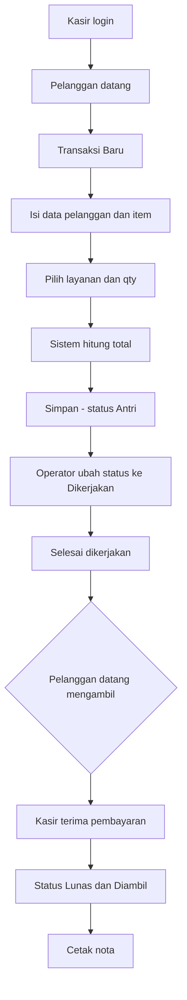
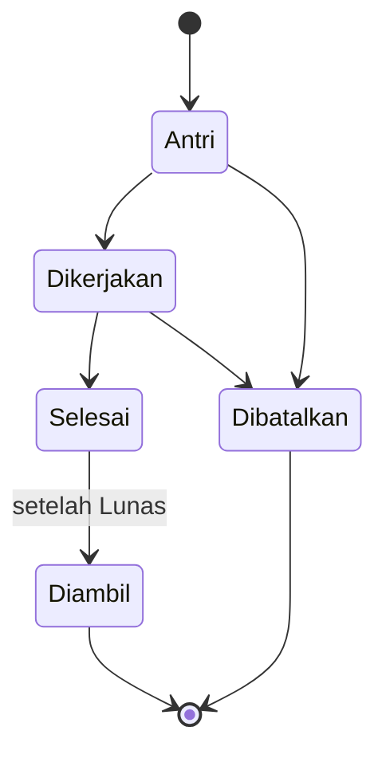
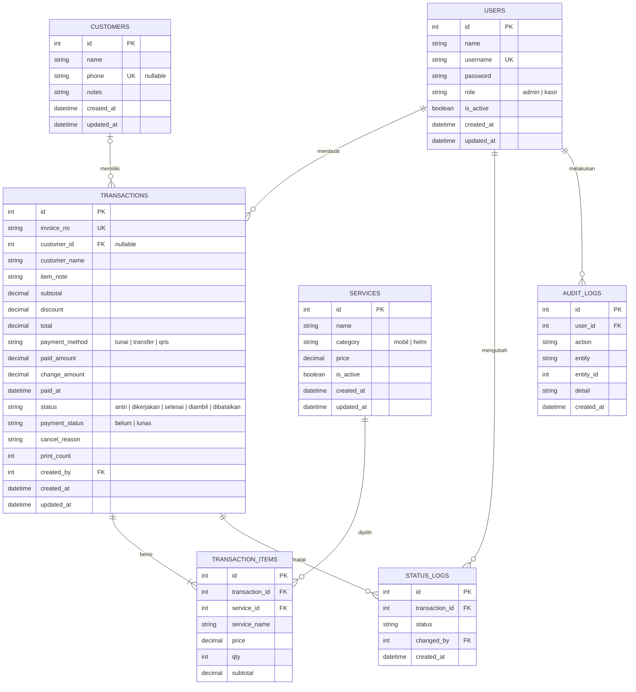

# PRD Aplikasi Cuci Mobil & Cuci Helm

**Framework:** CodeIgniter 4 · **UI:** Bootstrap 5 (bawaan) · **Versi:** 1.1 (MVP)

> Dokumen pendamping: `STYLE_GUIDE_UI.md` (tampilan) dan `AGENTS.md` (instruksi AI coding agent).

## 1. Ringkasan

Aplikasi web admin-kasir untuk mencatat transaksi usaha cuci mobil dan cuci helm. Kasir memilih jenis layanan, sistem menghitung biaya otomatis, status pengerjaan dipantau dari antrean hingga selesai, lalu pembayaran dicatat dan nota dicetak. Admin dapat mengelola layanan, pengguna, pengaturan usaha, dan melihat laporan.

## 2. Latar Belakang & Masalah

- Pencatatan manual rawan salah hitung dan nota hilang.
- Pemilik sulit mengetahui kendaraan/helm mana yang sedang dikerjakan dan mana yang siap diambil.
- Rekap pendapatan (per hari, per kasir, per metode bayar) memakan waktu.
- Tidak ada jejak siapa yang mengubah atau membatalkan transaksi.

## 3. Tujuan & Indikator Keberhasilan

| Tujuan | Indikator |
|---|---|
| Input transaksi cepat | Satu transaksi dibuat kurang dari 1 menit |
| Biaya akurat | Total dihitung otomatis dan divalidasi di server |
| Status terpantau | Setiap transaksi punya status yang terlihat di daftar |
| Rekap mudah | Laporan pendapatan harian/bulanan dan per kasir tersedia |
| Dapat diaudit | Perubahan penting (status, batal, harga layanan) tercatat |

## 4. Ruang Lingkup

**Termasuk (MVP):**
- Login, peran Admin dan Kasir
- Master jenis layanan dan harga
- Master pelanggan sederhana (opsional dipilih saat transaksi)
- Input transaksi berdasarkan jenis layanan
- Perhitungan biaya otomatis (subtotal, diskon, total, bayar, kembalian)
- Metode pembayaran: Tunai, Transfer, QRIS (dicatat manual)
- Manajemen status pengerjaan
- Pembatalan transaksi dengan alasan
- Daftar transaksi dengan filter dan pencarian
- Cetak nota
- Pengaturan usaha (nama, alamat, telepon, footer nota)
- Dashboard dan laporan (per periode, kategori, kasir, metode bayar) dengan ekspor
- Audit log aktivitas penting

**Fase 2 (di luar MVP):**
- Pembayaran sebagian / DP
- Buka-tutup shift dan rekonsiliasi kas harian
- Notifikasi WhatsApp
- Payment gateway
- Membership, poin, dan promo otomatis
- Penjadwalan antrean online
- Stok bahan (sampo, wax, pewangi)

## 5. Pengguna & Peran

| Peran | Hak akses |
|---|---|
| **Admin / Pemilik** | Semua fitur: layanan, pengguna, pengaturan usaha, laporan, audit log, ubah/batalkan transaksi lunas |
| **Kasir / Operator** | Buat transaksi, ubah status, terima pembayaran, cetak nota, kelola pelanggan, lihat transaksi sendiri/hari ini |

## 6. Alur Utama

## 7. Kebutuhan Fungsional

### 7.1 Autentikasi & Akses
- FR-01: Login dengan username dan password (`password_hash`).
- FR-02: Logout dan proteksi halaman lewat Filter CI4.
- FR-03: Pembatasan menu dan aksi berdasarkan peran.
- FR-04: Sesi berakhir otomatis setelah tidak aktif (default 2 jam, dapat diatur).
- FR-05: Admin dapat menambah, mengubah, menonaktifkan pengguna dan mereset password.

### 7.2 Master Jenis Layanan (Admin)
- FR-06: CRUD layanan: nama, kategori (Mobil/Helm), harga, status aktif.
- FR-07: Layanan nonaktif tidak muncul di form transaksi, riwayat tetap utuh.
- FR-08: Perubahan harga layanan dicatat di audit log.

Contoh data awal:

| Kategori | Layanan | Harga (contoh) |
|---|---|---|
| Mobil | Cuci Mobil Kecil (City Car) | Rp 40.000 |
| Mobil | Cuci Mobil Sedang (MPV/SUV) | Rp 50.000 |
| Mobil | Cuci Mobil Besar (Pick-up/Minibus) | Rp 65.000 |
| Mobil | Cuci + Vakum Interior | Rp 75.000 |
| Helm | Cuci Helm Half Face | Rp 20.000 |
| Helm | Cuci Helm Full Face | Rp 30.000 |
| Helm | Cuci Helm + Disinfektan Busa | Rp 40.000 |

### 7.3 Master Pelanggan
- FR-09: Pelanggan memiliki nama, no. HP (unik bila diisi), catatan.
- FR-10: Saat transaksi, kasir dapat mencari pelanggan lama (nama/no. HP) atau mengetik pelanggan baru; pelanggan umum (walk-in) tetap diperbolehkan tanpa data.
- FR-11: Halaman pelanggan menampilkan riwayat transaksinya.

### 7.4 Input Transaksi
- FR-12: Form berisi: pelanggan, plat nomor / keterangan item (mis. merek helm), catatan.
- FR-13: Pilih satu atau lebih layanan beserta qty; satu transaksi boleh memuat mobil dan helm sekaligus.
- FR-14: Harga layanan disalin ke item transaksi (harga historis tidak berubah bila master diubah).
- FR-15: Nomor transaksi otomatis, format `CW-YYYYMMDD-0001`.
- FR-16: Validasi: minimal 1 layanan, qty ≥ 1, pelanggan atau nama wajib terisi.

### 7.5 Perhitungan Biaya
- FR-17: Subtotal item = harga × qty.
- FR-18: Total kotor = jumlah seluruh subtotal item.
- FR-19: Diskon dapat berupa rupiah atau persen (opsional), tidak boleh melebihi total kotor.
- FR-20: **Total bayar = total kotor − diskon.**
- FR-21: Kembalian = uang diterima − total bayar; nominal kurang dari total ditolak (DP masuk Fase 2).
- FR-22: Perhitungan tampil langsung di form (JavaScript) dan dihitung ulang di server oleh `PriceCalculator`.

### 7.6 Pembayaran
- FR-23: Pembayaran dicatat dengan metode (Tunai, Transfer, QRIS), nominal diterima, kembalian, waktu, dan penerima (kasir).
- FR-24: Kembalian hanya dihitung untuk metode Tunai; Transfer dan QRIS nominal harus sama dengan total.
- FR-25: Status pembayaran: `belum` atau `lunas`.

### 7.7 Status Pengerjaan

| Status | Arti |
|---|---|
| Antri | Transaksi dibuat, belum dikerjakan |
| Dikerjakan | Sedang dicuci |
| Selesai | Pengerjaan selesai, menunggu diambil dan dibayar |
| Diambil | Sudah dibayar dan diambil pelanggan (final) |
| Dibatalkan | Dibatalkan dengan alasan (final) |

- FR-26: Perubahan status mengikuti alur di atas; mundur hanya oleh Admin.
- FR-27: Setiap perubahan status dicatat (status, waktu, pengguna).
- FR-28: Pembatalan wajib mengisi alasan; membatalkan transaksi yang sudah lunas hanya oleh Admin dan dicatat di audit log (pengembalian dana dicatat manual di luar sistem).
- FR-29: Status ditampilkan sebagai badge berwarna sesuai `STYLE_GUIDE_UI.md`.

### 7.8 Daftar & Detail Transaksi
- FR-30: Tabel dengan pagination, pencarian (no. transaksi, nama, plat), dan filter (tanggal, status, kategori, metode bayar, kasir).
- FR-31: Detail menampilkan item, rincian biaya, pembayaran, riwayat status, dan tombol aksi.
- FR-32: Cetak nota (struk 58/80 mm atau A5) berisi identitas usaha dari pengaturan, item, total, bayar, kembalian, nama kasir.
- FR-33: Cetak ulang nota dicatat jumlah cetaknya.

### 7.9 Pengaturan Usaha (Admin)
- FR-34: Nama usaha, alamat, telepon, teks footer nota, dan prefiks nomor transaksi dapat diatur.

### 7.10 Dashboard & Laporan
- FR-35: Dashboard: jumlah transaksi dan pendapatan hari ini, jumlah per status, pendapatan per kategori, dan 5 transaksi terbaru.
- FR-36: Laporan pendapatan per rentang tanggal, dapat difilter per kategori, kasir, dan metode bayar.
- FR-37: Laporan layanan terlaris (jumlah dan pendapatan per layanan).
- FR-38: Ekspor ke CSV/Excel (PDF opsional).
- FR-39: Pendapatan dihitung dari transaksi berstatus `diambil` (lunas); transaksi batal tidak dihitung.

### 7.11 Audit Log (Admin)
- FR-40: Dicatat: login gagal berulang, perubahan harga layanan, perubahan/penghapusan pengguna, pembatalan transaksi, pembukaan kembali transaksi final.
- FR-41: Admin dapat melihat dan memfilter log berdasarkan tanggal, pengguna, dan aksi.

## 8. Model Data

Tabel tambahan: `settings` (key-value: `business_name`, `address`, `phone`, `receipt_footer`, `invoice_prefix`).

Catatan data:
- Uang disimpan `DECIMAL(12,0)` (rupiah tanpa pecahan).
- Harga dan nama layanan disalin ke `transaction_items` agar riwayat tidak berubah.
- Transaksi tidak dihapus permanen (gunakan status `dibatalkan` atau soft delete).

## 9. Rancangan Halaman (UI)

Tampilan memakai Bootstrap 5 bawaan; detail komponen, warna, dan badge ada di `STYLE_GUIDE_UI.md`.

| Halaman | Isi utama |
|---|---|
| Login | Form username/password dalam card di tengah |
| Dashboard | Kartu statistik, tabel transaksi terbaru |
| Transaksi Baru | Pelanggan, pemilihan layanan dinamis (tambah baris), ringkasan biaya di samping |
| Daftar Transaksi | Filter, tabel, badge status, aksi cepat ubah status |
| Detail Transaksi | Rincian item, biaya, pembayaran, riwayat status, tombol bayar/batal/cetak |
| Pelanggan | Tabel pelanggan, pencarian, riwayat per pelanggan |
| Layanan (Admin) | Tabel layanan, modal tambah/ubah, aktif/nonaktif |
| Pengguna (Admin) | CRUD pengguna, reset password |
| Laporan (Admin) | Filter, tabel, total, ekspor |
| Pengaturan (Admin) | Identitas usaha dan footer nota |
| Audit Log (Admin) | Tabel log dengan filter |
| Nota cetak | Halaman tanpa navbar, siap cetak |

## 10. Rancangan Teknis (CI4)

**Stack:** PHP 8.1+, CodeIgniter 4, MySQL/MariaDB, Bootstrap 5, JavaScript vanilla/jQuery untuk form dinamis.

**Struktur utama:**
- `app/Controllers`: `Auth`, `Dashboard`, `Transactions`, `Customers`, `Services`, `Reports`, `Users`, `Settings`, `AuditLogs`
- `app/Models`: `UserModel`, `CustomerModel`, `ServiceModel`, `TransactionModel`, `TransactionItemModel`, `StatusLogModel`, `AuditLogModel`, `SettingModel`
- `app/Views`: `layouts/main.php`, `partials/`, folder per modul
- `app/Filters`: `AuthFilter`, `RoleFilter`
- `app/Libraries`: `PriceCalculator`, `AuditLogger`
- `app/Database/Migrations` dan `Seeds`

**Rute utama:**

| Method | URI | Fungsi |
|---|---|---|
| GET/POST | `/login`, `/logout` | Autentikasi |
| GET | `/dashboard` | Dashboard |
| GET | `/transactions` | Daftar |
| GET/POST | `/transactions/new`, `/transactions/create` | Input transaksi |
| GET | `/transactions/(:num)` | Detail |
| POST | `/transactions/(:num)/status` | Ubah status |
| POST | `/transactions/(:num)/pay` | Pembayaran |
| POST | `/transactions/(:num)/cancel` | Batalkan dengan alasan |
| GET | `/transactions/(:num)/print` | Cetak nota |
| Resource | `/customers` | Pelanggan |
| Resource | `/services`, `/users` | CRUD (Admin) |
| GET/POST | `/settings` | Pengaturan usaha (Admin) |
| GET | `/reports`, `/audit-logs` | Laporan dan log (Admin) |

**Catatan implementasi:**
- Simpan header transaksi, item, dan log status dalam satu transaksi database (`$db->transStart()`).
- Validation CI4 untuk semua input; CSRF aktif; output di view dibungkus `esc()`.
- Model/Query Builder dengan parameter binding.

## 11. Kebutuhan Non-Fungsional

- **Kinerja:** halaman utama termuat di bawah 2 detik pada jaringan biasa; daftar transaksi memakai pagination dan indeks pada kolom filter.
- **Keamanan:** password ter-hash, sesi aman, CSRF aktif, kontrol akses per peran, pembatasan percobaan login.
- **Kegunaan:** responsif, nyaman di laptop dan HP.
- **Keandalan:** backup database berkala; data transaksi tidak dihapus permanen.
- **Kompatibilitas:** Chrome, Edge, Firefox versi terbaru.
- **Zona waktu & format:** `Asia/Jakarta` (atau sesuai lokasi usaha), mata uang Rupiah, format tanggal `dd-mm-yyyy`.

## 12. Aturan Bisnis

1. Harga transaksi mengikuti harga master saat transaksi dibuat dan tidak berubah meski master diperbarui.
2. Transaksi `diambil` atau `dibatalkan` tidak dapat diedit (hanya Admin yang dapat membuka kembali, tercatat di audit log).
3. Status `diambil` hanya dapat dipilih setelah pembayaran `lunas`.
4. Diskon tidak boleh membuat total negatif.
5. Nomor transaksi unik dan berurutan per hari.
6. Pembatalan wajib beralasan.
7. Pendapatan laporan = jumlah total transaksi `diambil` pada rentang tanggal terpilih.

## 13. Kriteria Penerimaan

- Kasir dapat membuat transaksi dengan 2 layanan berbeda (mobil dan helm) dan total benar sebelum disimpan.
- Setelah disimpan, transaksi muncul di daftar berstatus Antri dengan nomor unik.
- Status berpindah berurutan Antri → Dikerjakan → Selesai → Diambil dan tiap perubahan tercatat.
- Pembayaran tunai kurang dari total ditolak; lebih dari total menghasilkan kembalian benar.
- Pembayaran Transfer/QRIS tersimpan dengan metode yang dipilih.
- Pembatalan tanpa alasan ditolak; membatalkan transaksi lunas oleh Kasir ditolak.
- Kasir tidak dapat membuka Layanan, Pengguna, Pengaturan, Laporan, dan Audit Log; Admin dapat.
- Nota menampilkan identitas usaha dari pengaturan, rincian, total, bayar, dan kembalian.
- Laporan harian sama dengan jumlah transaksi `diambil` pada tanggal tersebut dan dapat difilter per kasir dan metode bayar.
- Perubahan harga layanan dan pembatalan muncul di audit log.

## 14. Rencana Pengembangan

| Tahap | Cakupan | Estimasi |
|---|---|---|
| 1 | Setup CI4, migration, seeder, login, filter peran | 2–3 hari |
| 2 | CRUD layanan, pengguna, pelanggan, pengaturan usaha | 3 hari |
| 3 | Input transaksi + perhitungan biaya | 3–4 hari |
| 4 | Status, pembayaran (3 metode), pembatalan | 3 hari |
| 5 | Daftar, detail, cetak nota | 2 hari |
| 6 | Dashboard, laporan, ekspor, audit log | 3 hari |
| 7 | Pengujian, perbaikan, deployment | 2–3 hari |

## 15. Risiko & Mitigasi

| Risiko | Mitigasi |
|---|---|
| Perubahan harga memengaruhi data lama | Salin harga ke `transaction_items` |
| Kasir salah mengubah status | Batasi transisi dan catat log status |
| Manipulasi total dari klien | Hitung ulang di server |
| Kecurangan pembatalan transaksi lunas | Hanya Admin, wajib alasan, masuk audit log |
| Data hilang | Backup rutin dan soft delete |

## 16. Pengembangan Selanjutnya

- Pembayaran sebagian/DP dan tabel `payments` terpisah
- Buka-tutup shift dan rekonsiliasi kas
- Notifikasi WhatsApp saat status Selesai
- Membership, poin, dan promo/paket bundle
- Penjadwalan antrean online
- Manajemen stok bahan
